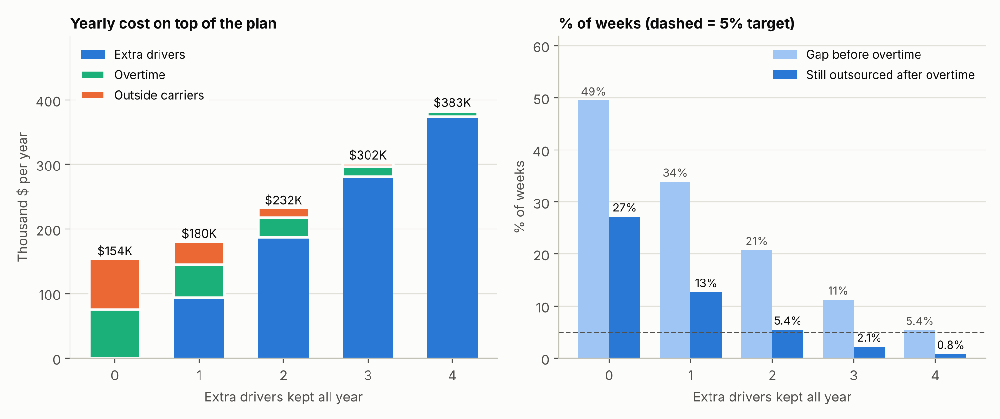
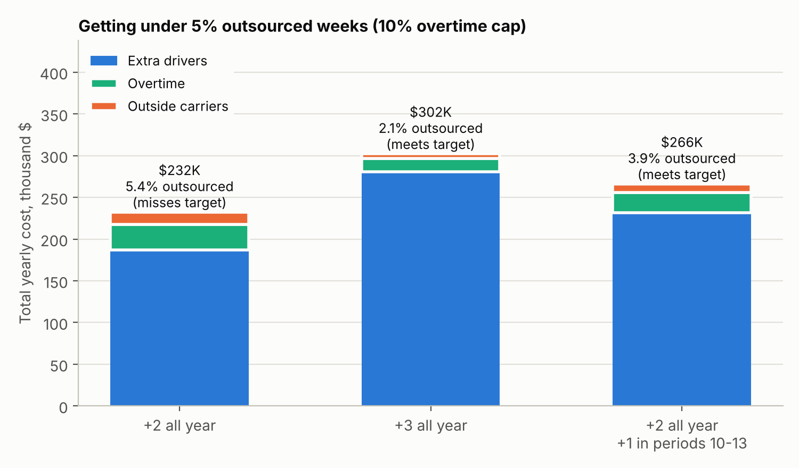
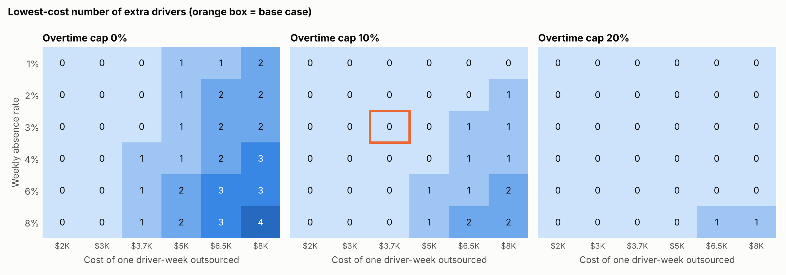

# How many extra drivers should a distribution center keep?

English | [中文](README.zh.md)

The original weekly data came from the course's partner company and is not public. This repo uses simulated data with a similar structure (a fictional distribution center with a 20-driver plan) to show the method. Every number below comes from the simulated data.

## Question

A yearly staffing model tells you how many drivers you need on average. But weekly volume goes up and down, and drivers miss weeks. Drivers can work some overtime, and anything beyond that goes to an outside carrier. How many extra drivers is it worth keeping on top of the plan?

## What I found

- **Overtime covers most absences.** If weekly volume were flat, absences alone would leave a gap in 46% of weeks. With up to 10% overtime, only 12% of weeks would still need an outside carrier.
- **What is left comes from busy weeks.** With no buffer, 27% of weeks still need an outside carrier after overtime. In the busy summer periods it is about 40% of weeks, in normal periods about 25%, and around the winter holidays almost none.
- **No buffer is cheapest; a buffer buys service.** With no buffer, overtime and outside carriers cost $154K a year. One extra driver costs $27K more ($180K) and cuts outsourced weeks from 27% to 13%.
- **Getting outsourced weeks under 5%** takes 3 extra drivers all year (2.1%, $302K), or 2 all year plus 1 more only in fiscal periods 10 to 13 (3.9%, $266K). The peak-season option is about $36K a year cheaper, even after paying $15,400 to hire and train the seasonal driver every year.
- **The overtime limit matters most.** To reach the 5% target you need 5 extra drivers with no overtime, 3 with 10% and 1 with 20%. With 10% overtime, the cheapest buffer is 0 in the base case and never more than 2 across the sensitivity grid.

So most absences can be handled with overtime. A buffer is mainly a way to use outside carriers less in busy weeks, and if that is the goal, a driver added only for the summer peak is cheaper than one kept all year.

Costs below are on top of the 20-driver plan, with a 10% overtime cap. Averages over 10,000 simulated years.

| Extra drivers all year | Weeks with a gap | Weeks outsourced after overtime | Overtime | Outside carriers | Extra drivers | Total |
|---:|---:|---:|---:|---:|---:|---:|
| 0 | 49% | 27% | $76K | $78K | $0 | $154K |
| 1 | 34% | 13% | $51K | $36K | $94K | $180K |
| 2 | 21% | 5.4% | $30K | $15K | $187K | $232K |
| 3 | 11% | 2.1% | $16K | $5K | $281K | $302K |
| 4 | 5.4% | 0.8% | $7K | $2K | $374K | $383K |

| Overtime cap | 0% | 10% | 20% |
|---|---:|---:|---:|
| Extra drivers needed for at most 5% outsourced weeks | 5 | 3 | 1 |







## How it works

1. **Simulated history.** Six years (2020 to 2025) of weekly miles for a fictional distribution center. The seasonal shape is rounded to steps of 0.05 (quieter around the winter holidays, busier in summer), with about ±10% random noise each week.
2. **Forecast.** Simple exponential smoothing on yearly miles with α = 0.75. The course model used the same α but also applied a seasonal factor to each four-week period; this repo keeps only the yearly level. On the simulated history the MAPE is 3.9%.
3. **Base crew.** A small linear program in PuLP sets the starting crew for the weekly simulation: cover the forecast miles, keep a minimum crew, stay under a hiring limit, account for training weeks, and minimize pay, hiring and training, and layoff costs. It gives 20 drivers. This is a simplified yearly version, not the course model, which re-planned fiscal 2025 across 13 four-week periods under mileage and target-headcount constraints. Its cost inputs are assumptions.
4. **Weekly simulation.** 10,000 simulated years. Each week, drivers needed = average need × seasonal index × random noise. Each driver is absent with a 3% chance. A gap is filled with overtime first (each available driver can work up to 10% more), and whatever is left goes to an outside carrier.
5. **Comparisons.** All-year buffers of 0 to 4, all-year plus peak-season mixes, and a sensitivity grid over overtime cap (0%, 10%, 20%), outsourcing cost and absence rate.

## Assumptions

All inputs live in [`src/assumptions.py`](src/assumptions.py).

| Input | Value | Source or note |
|---|---|---|
| Cost of one extra driver for a week | $1,800 | BLS OEWS, May 2023: Washington mean wage for heavy and tractor-trailer truck drivers, $30.36/hour × 40 hours (assumption), grossed up with BLS ECEC, Sep 2025 (wages are about 68% of total pay for transportation and material moving jobs). |
| Overtime | up to 10% more hours, about $1,820 per driver-week of work | Assumption: overtime is paid at 1.5 × $30.36/hour with no extra benefits. |
| Cost of one driver-week sent to an outside carrier | $3,700 | Assumption: an outside carrier covers 2,000 miles at ATRI's 2025 average cost of $2.336/mile, minus the $0.48/mile of fuel our own truck saves (ATRI). |
| Absence rate | 3% per driver per week | BLS CPS 2024, Table 47: 3.2% of full-time workers were absent in a given week. Assumption: absences are whole weeks and independent. |
| Miles per driver per week | 2,000 | Assumption, a common figure for regional drivers. |
| Hire and train one driver | $15,400 | UGPTI (2000), The Costs of Truckload Driver Turnover: $8,234 per driver in 2000 dollars. Moved to 2025 dollars with the BLS CPI-U annual average: 8,234 × 321.943 / 172.2 ≈ $15,400. Assumption: a seasonal driver has to be hired and trained every year. |
| Layoff cost | 2 weeks of pay | Assumption. |
| Starting crew, minimum crew, hiring limit, training | 18, 16, 6 a year, 4 weeks | Fictional. |
| Seasonal shape, weekly noise | rounded | Fictional, rounded to keep the structure simple. |

## Limitations

- Overtime is assumed to be available whenever it is needed, up to the cap. Hours-of-service rules and fatigue are not modeled, and overtime pay leaves out payroll taxes.
- Absences are whole weeks and independent, so there is no flu season or several drivers out at once.
- Seasonal drivers are assumed to be hired and trained before period 10.
- Costs are assumptions. The sensitivity grid shows how much the answer moves when they change.

## Run it

```bash
pip install -r requirements.txt
python src/run_all.py
pytest
```

`run_all.py` writes the simulated data to `data/simulated/`, tables to `results/` and the figures to `figures/`. CI runs the tests and a smaller simulation on every push.

## Sources

- BLS, [Occupational Employment and Wages, May 2023: Heavy and Tractor-Trailer Truck Drivers](https://www.bls.gov/oes/2023/may/oes533032.htm)
- BLS, [Employer Costs for Employee Compensation by occupational group](https://www.bls.gov/charts/employer-costs-for-employee-compensation/costs-by-occupational-group.htm)
- BLS, [CPS 2024 Table 47: Absences from work of employed full-time wage and salary workers](https://www.bls.gov/cps/data/aa2024/cpsaat47.pdf)
- BLS, [Consumer Price Index, U.S. city average, annual averages](https://www.bls.gov/regions/mid-atlantic/data/consumerpriceindexhistorical_us_table.htm)
- ATRI, An Analysis of the Operational Costs of Trucking, 2026 update, as reported by [Transport Topics](https://www.ttnews.com/articles/atri-truck-costs-2025)
- UGPTI, [The Costs of Truckload Driver Turnover (2000)](https://www.ugpti.org/resources/reports/downloads/sp-146.pdf)

Built on a UW QMETH 450 team project (Sep–Dec 2025), where I cleaned and condensed the team's data and built the Excel Solver model. This repo is my follow-up after the course, built with help from AI coding tools.
