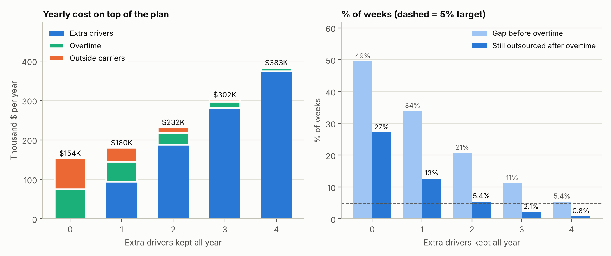
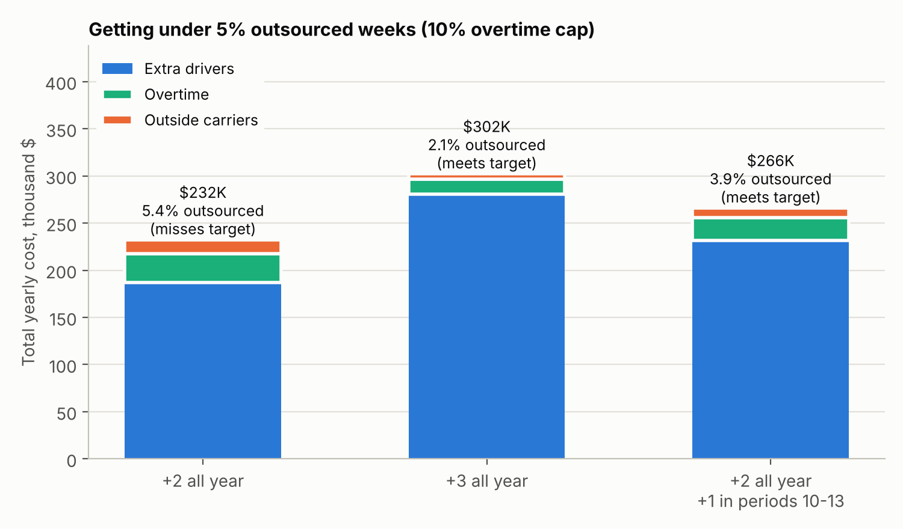
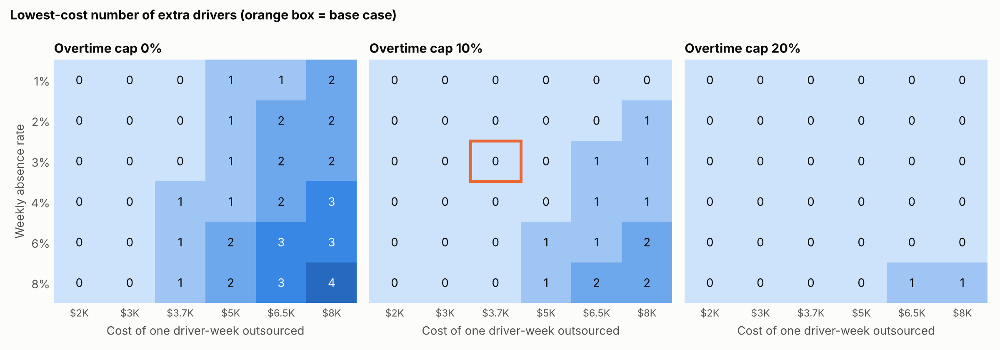

# 配送中心该多留几个司机？

[English](README.md) | 中文

原始的每周数据来自课程合作方，不公开。本 repo 用结构相似的模拟数据（一个虚构的配送中心，年度计划 20 名司机）演示方法。下面所有数字都来自模拟数据。

## 问题

年度人员模型给出的是平均需要多少司机。但每周货量有起伏，司机也会请假。人手不够时，司机可以加一点班，再不够就交给外包承运商。在计划之上多留几个司机最划算？

## 结论

- **大部分请假靠加班就能顶住。** 如果每周货量不变，只看请假，46% 的周会有缺口；允许最多 10% 的加班后，只有 12% 的周还需要外包。
- **剩下的缺口主要出在忙的周。** 不留缓冲时，加班后仍有 27% 的周需要外包。夏季旺季大约 40% 的周要外包，平常时期约 25%，冬季假期前后几乎没有。
- **不留缓冲最省钱，缓冲换来的是服务。** 不留缓冲时，加班加外包每年 $15.4 万。多留 1 人每年多花 $2.7 万（共 $18.0 万），需要外包的周从 27% 降到 13%。
- **要把外包周控制在 5% 以内**，全年需要多留 3 人（2.1%，每年 $30.2 万）；或者全年多留 2 人、只在财年第 10 到 13 期再加 1 人（3.9%，每年 $26.6 万）。旺季方案每年便宜约 $3.6 万，这已经算上旺季司机每年 $15,400 的招聘培训费。
- **加班上限影响最大。** 要达到 5% 目标，不能加班时需要多留 5 人，加班上限 10% 时需要 3 人，20% 时只要 1 人。加班上限 10% 时，基准情况下最省钱的缓冲是 0 人，整个敏感性分析里最多也只到 2 人。

所以大部分请假可以靠加班解决。缓冲主要是为了在忙的周少用外包；如果目标是这个，只在夏季旺季加 1 个司机，比全年多养 1 个更便宜。

下表成本都是 20 人计划之外的部分，加班上限 10%，结果是 10,000 个模拟年份的平均值。

| 全年多留人数 | 有缺口的周 | 加班后仍需外包的周 | 加班 | 外包运输 | 多留司机 | 合计 |
|---:|---:|---:|---:|---:|---:|---:|
| 0 | 49% | 27% | $7.6 万 | $7.8 万 | $0 | $15.4 万 |
| 1 | 34% | 13% | $5.1 万 | $3.6 万 | $9.4 万 | $18.0 万 |
| 2 | 21% | 5.4% | $3.0 万 | $1.5 万 | $18.7 万 | $23.2 万 |
| 3 | 11% | 2.1% | $1.6 万 | $0.5 万 | $28.1 万 | $30.2 万 |
| 4 | 5.4% | 0.8% | $0.7 万 | $0.2 万 | $37.4 万 | $38.3 万 |

| 加班上限 | 0% | 10% | 20% |
|---|---:|---:|---:|
| 外包周不超过 5% 需要多留的人数 | 5 | 3 | 1 |







## 做法

1. **模拟历史数据。** 虚构配送中心 2020 到 2025 年的每周里程。季节性形状取整到 0.05（冬季假期前后较闲，夏季较忙），每周再加约 ±10% 的随机波动。
2. **预测。** 对每年总里程做简单指数平滑，α = 0.75，和课程项目用的方法一样。在模拟数据上 MAPE 为 3.9%。
3. **年度计划。** 用 PuLP 按项目描述重建线性规划：满足预测里程，保持最低人数，不超过每年招聘上限，考虑新人培训周数，最小化工资、招聘培训和裁员成本。结果是 2026 到 2030 年都需要 20 名司机。这是重建，不是复现课程模型，成本参数都是假设。
4. **按周模拟。** 模拟 10,000 年。每周需要的司机 = 平均需求 × 季节指数 × 随机波动。每个司机每周有 3% 的概率请假。出现缺口时先用加班补（每个到岗司机最多多干 10%），剩下的交给外包。
5. **对比。** 全年多留 0 到 4 人，全年加旺季的组合，以及加班上限（0%、10%、20%）、外包成本和请假率的敏感性分析。

## 假设

所有参数都在 [`src/assumptions.py`](src/assumptions.py)。

| 参数 | 取值 | 来源或说明 |
|---|---|---|
| 多养 1 个司机一周 | $1,800 | BLS OEWS 2023 年 5 月：华盛顿州重卡司机平均时薪 $30.36 × 每周 40 小时（假设），再按 BLS ECEC 2025 年 9 月数据折算福利（运输类岗位工资约占总薪酬 68%）。 |
| 加班 | 最多多干 10% 工时，相当于 1 个司机一周的活约 $1,820 | 假设：加班按 1.5 × $30.36/小时支付，不另算福利。 |
| 1 个司机一周的活交给外包 | $3,700 | 假设：2,000 英里交给外包承运商，按 ATRI 2025 年平均运营成本 $2.336/英里计算，减去自有车辆省下的燃油 $0.48/英里（ATRI）。 |
| 请假率 | 每人每周 3% | BLS CPS 2024 年表 47：全职员工每周缺勤率 3.2%。假设：请假以整周计，各司机之间相互独立。 |
| 每个司机每周里程 | 2,000 英里 | 假设，区域司机的常见水平。 |
| 招聘和培训 1 个司机 | $15,400 | UGPTI（2000）司机流失成本研究：每人 $8,234（2000 年美元）。按 BLS CPI-U 年均值换算成 2025 年美元：8,234 × 321.943 / 172.2 ≈ $15,400。假设：旺季司机每年都要重新招聘和培训。 |
| 裁员成本 | 2 周工资 | 假设。 |
| 初始人数、最低人数、招聘上限、培训 | 18 人、16 人、每年 6 人、4 周 | 虚构。 |
| 季节性形状、每周波动 | 取整 | 虚构，取整以保持结构简单。 |

## 局限

- 假设需要时总能加班（不超过上限）。没有考虑司机工时法规和疲劳，加班费也没算雇主要交的税。
- 请假按整周算且相互独立，没有考虑流感季或多人同时请假。
- 假设旺季司机能在第 10 期之前招到并培训好。
- 成本都是假设，敏感性分析显示了结论会怎么变。

## 运行

```bash
pip install -r requirements.txt
python src/run_all.py
pytest
```

`run_all.py` 会把模拟数据写到 `data/simulated/`，结果表写到 `results/`，图写到 `figures/`。每次 push，CI 会跑测试和一个较小规模的模拟。

## 来源

- BLS，[Occupational Employment and Wages, May 2023: Heavy and Tractor-Trailer Truck Drivers](https://www.bls.gov/oes/2023/may/oes533032.htm)
- BLS，[Employer Costs for Employee Compensation by occupational group](https://www.bls.gov/charts/employer-costs-for-employee-compensation/costs-by-occupational-group.htm)
- BLS，[CPS 2024 Table 47: Absences from work of employed full-time wage and salary workers](https://www.bls.gov/cps/data/aa2024/cpsaat47.pdf)
- BLS，[Consumer Price Index, U.S. city average, annual averages](https://www.bls.gov/regions/mid-atlantic/data/consumerpriceindexhistorical_us_table.htm)
- ATRI，An Analysis of the Operational Costs of Trucking，2026 年版，[Transport Topics 报道](https://www.ttnews.com/articles/atri-truck-costs-2025)
- UGPTI，[The Costs of Truckload Driver Turnover (2000)](https://www.ugpti.org/resources/reports/downloads/sp-146.pdf)

基于 UW QMETH 450 团队项目（2025 年 9 到 12 月）。我在项目中负责清理、精简团队数据，并搭建 Excel Solver 模型。这个 repo 是我课后的个人延伸，借助 AI 编程工具完成。
